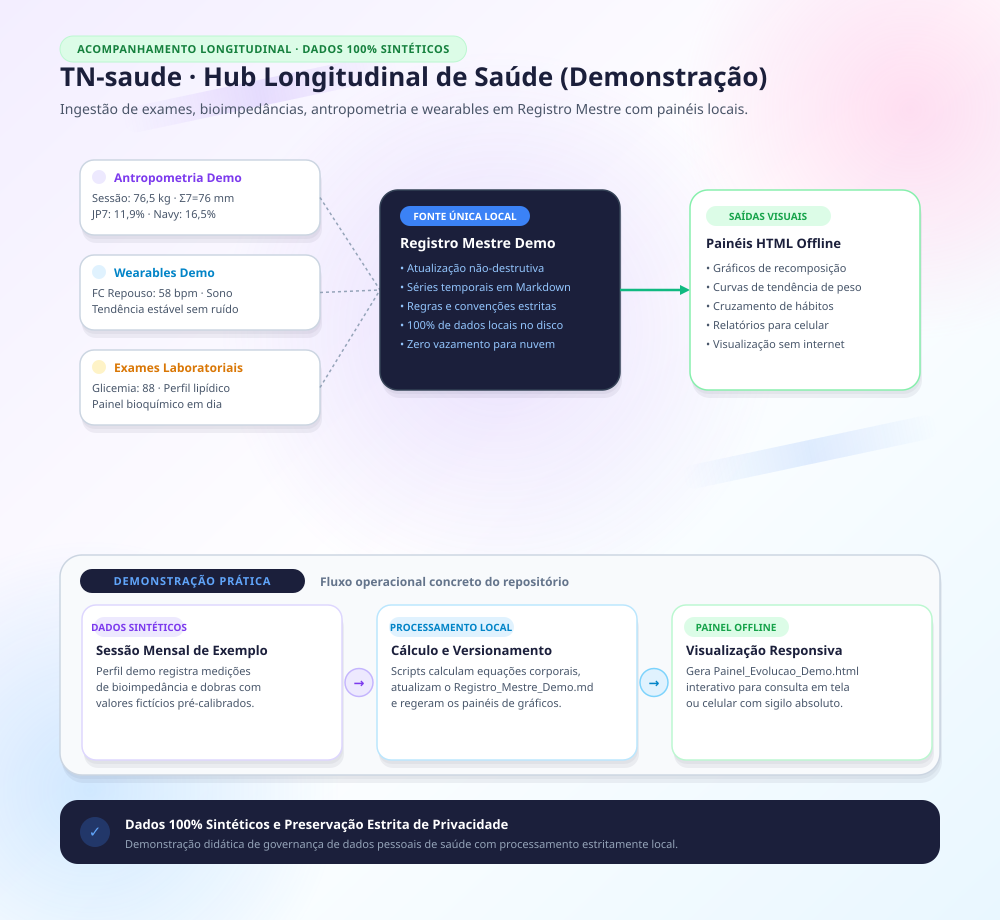

> **Nota de Privacidade:** Todos os parâmetros fisiológicos, medidas, datas e registros de exemplo neste repositório são **100% sintéticos e fictícios**, criados exclusivamente para demonstrar o funcionamento dos scripts, fórmulas antropométricas e skills.

---

# saude

Repositório público demonstrativo do projeto de saúde e acompanhamento corporal: ingestão de exames laboratoriais, balanças de bioimpedância, antropometria, fotos corporais, treinos, wearables e prescrições didáticas integradas em um Registro Mestre local.

- **Skills especializadas (`.claude/skills/`):**
  - `saude-antropometria`: Cálculo de Jackson-Pollock 7, US Navy, RCQ, RCE, CMB e AMA corrigida com validação automatizada.
  - `saude-balancas`: Tratamento de bioimpedâncias domésticas e clínicas octapolares com pareamento e filtragem de ruído.
  - `saude-exames`: Extração de texto de PDFs laboratoriais e OCR de laudos digitalizados.
  - `saude-fotos`: Processamento fotográfico corporal (HEIC/JPG), rotação, extração de quadros e pranchas comparativas.
  - `saude-receitas`: Gestão estruturada de cronogramas, posologias didáticas e checagem de interações.
  - `saude-registro`: Regras de versionamento, integridade e atualização concorrente do Registro Mestre.
  - `saude-treino`: Extração de tonelagem, regularidade de séries e exercícios âncora.
  - `saude-wearables`: Consolidação e análise temporal de dados de frequência cardíaca, sono e passos.
